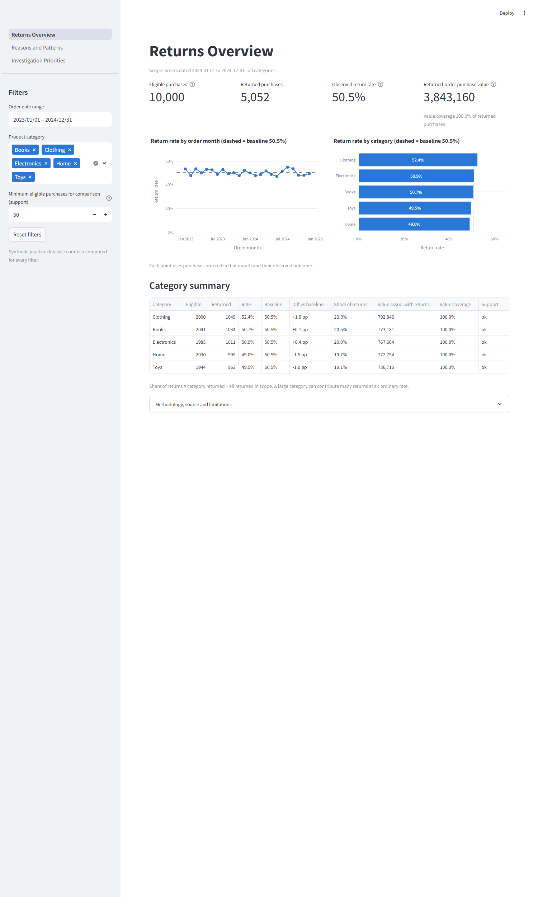
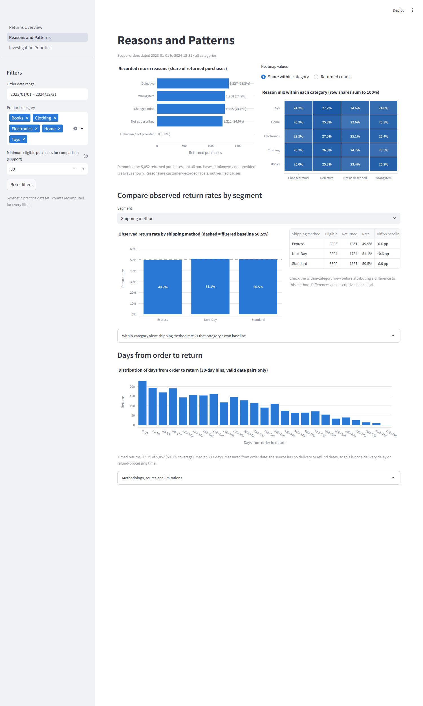
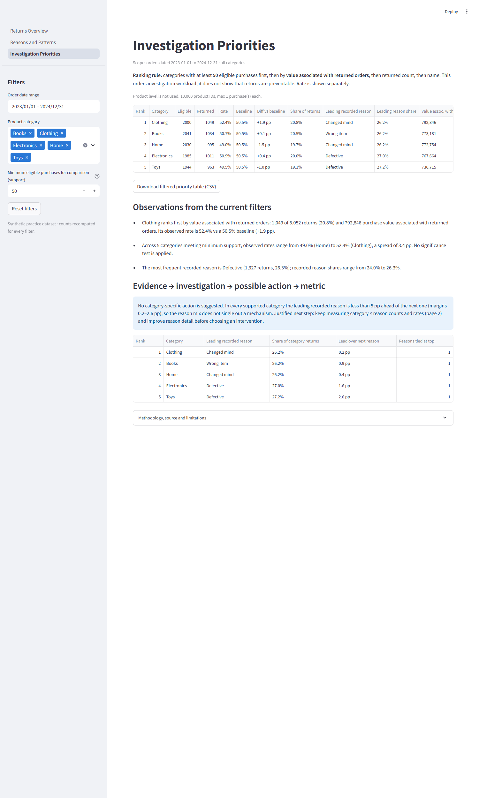

# E-commerce Returns Analytics

A descriptive analytics project: public dataset → Python profiling and cleaning → DuckDB SQL checks and
analysis → three-page Streamlit dashboard → documented findings.

It answers:

1. What proportion of observed purchases were returned?
2. Which categories contribute most to returns? (Product level is not supported by this data; see below.)
3. What reasons are recorded for returns?
4. How do observed return rates differ across shipping methods, payment methods and price groups?
5. Which issues merit investigation first, and what evidence supports that priority?

## Data

*Synthetic Dataset for E-Commerce Return Analysis* by Sayali Khot (`sayalikhot21`), Kaggle, MIT licence:
https://www.kaggle.com/datasets/sayalikhot21/synthetic-dataset-for-e-commerce-return-analysis

**This is synthetic practice data, not real company transactions.** Its rates are not industry benchmarks.

* 10,000 rows, one row per purchase; order dates 2023-01-01 to 2024-12-31; 5 categories.
* 5,052 returned and 4,948 not returned; all outcomes known; 0 rows excluded by cleaning.
* Every product ID and user ID appears once, so analysis is at category level.
* 2,513 returns have a return date before the order date. They count as returns but are excluded from timing.

Details: [docs/data_source.md](docs/data_source.md) · [docs/data_dictionary.md](docs/data_dictionary.md) ·
[docs/metric_definitions.md](docs/metric_definitions.md)

## Results in brief

The signal is weak. The observed return rate is 50.5% (5,052 / 10,000). Category rates range from 49.0%
(Home) to 52.4% (Clothing). Shipping, payment and price-band rates fall within about 3 pp of each other.
Recorded reasons are close to 25% each (Defective 26.3% to Not as described 24.0%). No category-specific
action is justified. The supported recommendations concern reason coding and date capture.
Full write-up with counts and source queries: [docs/findings.md](docs/findings.md).

## Project layout

```
pipeline.py                 clean → build DuckDB (one transaction) → checks → export results
src/clean_data.py           cleaning rules and audit trail (pandas)
src/database.py             DuckDB build / read-only connection
src/validate.py             integrity checks + reconciliation
src/queries.py              shared SQL execution layer (bound parameters, whitelisted dimensions)
src/config.py               paths and display settings
sql/00_schema.sql           tables, keys, analytics view
sql/00_data_checks.sql      integrity checks
sql/01_…10_*.sql            analyses (question, grain, denominator and caveat in each header)
dashboard/app.py            entry point, shared filters, navigation
dashboard/views/            the three pages
dashboard/insights.py       numeric sentence templates for page 3
tests/                      pytest (tiny artificial fixtures only)
outputs/                    exported query results, quality report, issue report, run metadata
docs/                       source, dictionary, metrics, findings, interview guide, screenshots
```

## Setup

Requires Python 3.11+ (tested with 3.12.2). Versions used are pinned in `requirements.txt`.

Create a project-local virtual environment (recommended):

```bash
# Windows (PowerShell)
python -m venv .venv
.venv\Scripts\Activate.ps1

# macOS / Linux
python3 -m venv .venv
source .venv/bin/activate
```

Then:

```bash
python -m pip install -r requirements.txt
```

Download the dataset (see [docs/data_source.md](docs/data_source.md)) and place
`ecommerce_returns_synthetic_data.csv` in `data/raw/`.

## Run

```bash
python pipeline.py                                                   # build data/analytics.duckdb + outputs
python -m pytest -q                                                  # tests
python -m streamlit run dashboard/app.py --server.address 127.0.0.1  # dashboard
```

Once the packages and data are in place, everything runs offline. Streamlit usage statistics are
disabled in `.streamlit/config.toml`. Stop the dashboard before rebuilding the database: if the file is
locked, the pipeline exits with a clear message (exit code 3). The dashboard opens the database
read-only, and its cached results are keyed on the database file's build stamp, so a rebuild is never
served stale.

## Dashboard

1. **Returns Overview**: eligible / returned / rate / purchase value associated with returned orders;
   monthly order-cohort rate; category rates with baseline; category summary table.
2. **Reasons and Patterns**: recorded reasons (Unknown always shown), category × reason heatmap,
   shipping / payment / price-band comparison (overall and within category), days-from-order-to-return
   distribution with coverage.
3. **Investigation Priorities**: transparent ranking table with minimum-support control and CSV
   download, filter-responsive observations, and an evidence → investigation → action → metric table
   (shown only when a leading reason clearly leads).

Shared filters: order-date range, categories, minimum support, reset. Each page has a methodology note.

| Overview | Reasons and patterns | Priorities |
|---|---|---|
|  |  |  |

## Limitations

* Synthetic data; no causal or real-world conclusions.
* No cancellation, delivery, refund or partial-return fields. "Value associated with returned orders" is
  not a refund or a loss.
* Currency is the publisher's statement (USD) and is shown without a symbol. Discount is not analysed.
* Timing is available for 50.3% of returns only.
* No observation cutoff is documented, so recent cohorts may be incomplete.
* The minimum-support and 5 pp reason-lead thresholds are display rules, not statistical tests.

## Data citation

Khot, S. (2024). *Synthetic Dataset for E-Commerce Return Analysis* (Version 1) [Data set]. Kaggle.
https://www.kaggle.com/datasets/sayalikhot21/synthetic-dataset-for-e-commerce-return-analysis. MIT licence.
